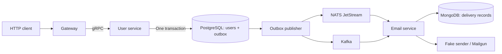

# prostack-go-showcase — Go backend starter

**Start with business logic. The infrastructure is already connected.**

A **Go backend starter and microservices reference application** built on [prostack-go](https://github.com/crylabsorg/prostack-go). Follow a working HTTP → gRPC → PostgreSQL → transactional outbox → NATS JetStream and Kafka → email workflow, with OpenTelemetry instrumentation, health checks, and integration tests already wired together.

prostack means **production stack**. It grew out of a recurring problem: across projects and companies, the same infrastructure work had to happen before the first business feature. `prostack-go` makes that foundation reusable; this showcase demonstrates how to build on it.

[Quick start](#quick-start) · [Architecture](#architecture) · [Use it for your project](#use-it-for-your-project) · [Development](#development) · [Troubleshooting](#troubleshooting) · [Contributing](#contributing)

## Why prostack?

Connecting a database is straightforward. Connecting configuration, graceful shutdown, HTTP and gRPC errors, event publishing, consumers, tracing, and tests consistently takes more work—and that work repeats with every new backend.

prostack gives you a foundation you can inspect and a small application that shows how the pieces fit. Start from a working integration, then put your domain logic in ordinary Go packages.

- **Build features sooner.** Reuse application bootstrap, configuration, logging, database connections, transports, and telemetry.
- **Learn from a complete workflow.** See a database transaction become an event and an asynchronous side effect.
- **Keep the code explicit.** Each service groups its domain, repository, business logic, errors, and controllers in one package. Dependencies are wired in `main.go`.
- **Verify against real dependencies.** Integration tests use Testcontainers for PostgreSQL, MongoDB, NATS, and Kafka.

### Two repositories, two roles

| Repository | What it contains | Start here when… |
| --- | --- | --- |
| [prostack-go](https://github.com/crylabsorg/prostack-go) | Reusable Go packages for infrastructure and application lifecycle, plus shared Make targets. | You want to use the foundation in an existing backend. |
| **prostack-go-showcase**—this repository | Three runnable services, API contracts, migrations, tests, and local Docker Compose dependencies. | You want a Go starter template or a concrete implementation to study and adapt. |

This is for Go backend developers and teams starting services, standardizing infrastructure, or learning event-driven Go architecture. The showcase is deliberately small: user creation and welcome email delivery make the infrastructure visible without hiding it behind a large business domain.

To adopt individual packages or start with a service that needs no databases or brokers, use the [prostack-go README and standalone quick start](https://github.com/crylabsorg/prostack-go#quick-start).

## Quick start

The walkthrough runs infrastructure in Docker and the three Go applications on your host. It uses plain HTTP on localhost; custom domains and TLS are optional.

### 1. Prepare your tools and checkout

- **Go 1.27.1**, as declared in the Go modules.
- **Docker with Docker Compose** and a running Docker daemon. The walkthrough is verified with Docker **29.8.2** and Compose **5.6.0**.
- **Atlas 1.3.0** on your `PATH` for database migrations; use the [pinned release](https://github.com/ariga/atlas/releases/tag/v1.3.0).
- Git, Make, and curl. Commands below use a POSIX shell on macOS or Linux.

```sh
git clone --recurse-submodules https://github.com/crylabsorg/prostack-go-showcase.git
cd prostack-go-showcase
make mod-download
```

The submodule is required: application modules resolve `prostack-go` through local `replace` directives, and the root Makefile includes its targets. Generated protobuf and HTTP code is committed, so code generators are not needed for the first run.

### 2. Start the dependencies

Run from the repository root:

```sh
docker compose -f devops/docker-compose.yaml up -d postgres mongo nats kafka jaeger
docker compose -f devops/docker-compose.yaml ps
docker compose -f devops/docker-compose.yaml exec -T postgres pg_isready -U postgres -d postgres
```

Wait for PostgreSQL to report `accepting connections`. Containers may take a few seconds to initialize, especially MongoDB's replica set and Kafka. If a dependency is still starting, inspect its logs before continuing:

```sh
docker compose -f devops/docker-compose.yaml logs --tail=50 postgres mongo nats kafka
```

This starts the dependencies used by the demo. Redis is available in Compose but unused by this workflow; Traefik is optional. The required host ports are `5432`, `27017`, `4222`, `9092`, `4317`, `4318`, and `16686`.

### 3. Apply the database migration

```sh
make migrate-up-user
```

Atlas applies the checked-in migration to the local PostgreSQL database. MongoDB's delivery collection is initialized by the email service.

### 4. Run the applications

Open three terminals at the repository root and run one command in each:

```sh
# Terminal 1
make run-user
```

```sh
# Terminal 2
make run-email
```

```sh
# Terminal 3
make run-gateway
```

In a fourth terminal, check all three processes:

```sh
curl --fail -i http://localhost:33001/readyz
curl --fail -i http://localhost:33002/readyz
curl --fail -i http://localhost:33000/readyz
```

Wait for HTTP 200 from each. Readiness checks cover registered probes, not the entire event pipeline; the next steps verify the application workflow.

### 5. Create and fetch a user

```sh
curl --fail-with-body -i http://localhost:33000/v1/users \
  -H 'Content-Type: application/json' \
  -d '{"email":"ada.lovelace@example.com","first_name":"Ada","last_name":"Lovelace"}'
```

Expect **HTTP 201 Created** and a JSON body like this; the `id` will be different:

```json
{
  "id": "4edc7ba0-7d59-42aa-962d-1310cda19559",
  "email": "ada.lovelace@example.com",
  "first_name": "Ada",
  "last_name": "Lovelace"
}
```

Copy the returned ID into the following command:

```sh
USER_ID='<id from the POST response>'
curl --fail-with-body "http://localhost:33000/v1/users/${USER_ID}"
```

Expect **HTTP 200** and the same user. Creating the same email again returns **409 Conflict**; use a different email when repeating the demo.

### 6. Follow the asynchronous result

The email terminal should log **`fake welcome email`** with the user's ID and email address. The default provider logs delivery without sending real email or requiring external credentials.

You can also inspect the two database records:

```sh
docker compose -f devops/docker-compose.yaml exec -T postgres \
  psql -U postgres -d postgres \
  -c 'SELECT user_id, subject, processed_at FROM user_outbox ORDER BY id DESC LIMIT 5;'

docker compose -f devops/docker-compose.yaml exec -T mongo \
  mongosh --quiet email \
  --eval 'db.welcome_deliveries.find({}, {_id: 1, sent_at: 1}).toArray()'
```

For your user, `processed_at` becomes non-null after both brokers acknowledge publication, and `sent_at` records the committed welcome delivery. These changes are asynchronous; retry the queries if needed.

### Explore and stop

| Local URL | What to inspect |
| --- | --- |
| [Swagger UI](http://localhost:33000/swagger/) | Try the HTTP API. |
| [OpenAPI JSON](http://localhost:33000/swagger.json) | Import the HTTP contract into your API client. |
| [AsyncAPI UI](http://localhost:33000/asyncapi) | Explore `user.created` and its broker bindings. |
| [Jaeger](http://localhost:16686) | Inspect traces; default service names are `gateway`, `app1` (the user service), and `email`. |
| [Gateway application metrics](http://localhost:33000/metrics) | Application, Go, and process registry; user and email expose `/metrics` on ports `33001` and `33002`. |
| [Gateway OpenTelemetry metrics](http://localhost:33000/otel-metrics) | OpenTelemetry metrics via the configured `ps_prometheus` exporter; also exposed by user and email. |

Asynchronous work appears in linked traces; inspect span links when following work from the outbox to the consumers.

Press Ctrl+C in each application terminal and wait for the processes to exit before stopping the local dependencies. Worker draining can take a few seconds.

```sh
make dev-down
```

Docker volumes retain your data for the next run. For the optional Traefik HTTPS route, see [local certificates and domains](devops/README.md).

## Architecture

The example crosses a real consistency boundary: committing a user and delivering a welcome email happen at different times.



1. The [HTTP gateway](apps/gateway/user/http.go) converts request DTOs into a gRPC call.
2. The [user service](apps/user/user/service.go) validates input and writes the user and `user.created` outbox entry in one PostgreSQL transaction.
3. The [outbox adapter](apps/user/user/outbox.go) connects the application's persistence to the shared publisher. The [user bootstrap](apps/user/main.go) configures fanout to **both** NATS JetStream and Kafka.
4. The email service's [NATS](apps/email/email/nats.go) and [Kafka](apps/email/email/kafka.go) controllers consume the event and call [business logic](apps/email/email/service.go).
5. A [MongoDB delivery record](apps/email/email/repository.go), keyed by user ID, suppresses already committed welcome deliveries across the two consumers.

Publication is **at least once**. An outbox entry completes only after every configured publisher succeeds; a partial failure retries publication to both brokers. Consumers must tolerate duplicates. A successful external email send followed by a failed MongoDB commit can still cause another send on retry. This example does not guarantee exactly-once email delivery or event processing order.

### What is already connected?

| Concern | Implementation in this showcase |
| --- | --- |
| HTTP and gRPC | Generated HTTP routes and DTOs, protobuf contracts, explicit gateway conversions, shared error handling. |
| PostgreSQL | pgx repositories, transactions, Atlas migrations, and a transactional outbox. |
| Messaging | Durable NATS JetStream consumer and Kafka consumer, acknowledgements/commits, retries, and shared event contracts. |
| MongoDB | Transactional welcome-delivery records shared by both consumers. |
| Observability | Structured logging, OpenTelemetry instrumentation and context propagation, Jaeger, and Prometheus-format endpoints. |
| Application lifecycle | Configuration loading, startup, health probes, worker draining, and cleanup through `ps_bootstrap`. |
| Testing and tooling | Unit and integration tests, Testcontainers, shared Make targets, and pinned generator/linter versions. |

Malformed JSON events are logged and terminated or skipped by the consumers. There is no dead-letter queue in the example. Compose includes Jaeger; Prometheus and Grafana servers are not bundled.

### Find your way around

```text
apps/
  gateway/           HTTP API, DTOs, OpenAPI and AsyncAPI documents
  user/              gRPC service, PostgreSQL schema and migrations
  email/             NATS/Kafka consumers, MongoDB records, email providers
pkg/
  events/            Shared event types and subjects
  proto/             Generated Go protobuf and gRPC code
proto/               Protobuf source contracts
devops/              Local dependencies and optional Traefik configuration
prostack-go/         Reusable foundation, checked out as a Git submodule
```

Within a service package, `domain.go` defines domain types, `repository.go` handles persistence, and `service.go` owns business logic. Transport code lives in `grpc.go`, `http.go`, `nats.go`, or `kafka.go`. Gateway DTOs and HTTP routes are generated in `api.gen.go`; conversions live in `dto.go`. Start reading at each application's `main.go` to see how dependencies are assembled.

## Use it for your project

Use the showcase as a starting point when you want the demonstrated architecture, or study individual integrations and adopt `prostack-go` in an existing codebase.

1. **Run the example first.** Establish a working baseline before replacing the domain.
2. **Replace the user/email workflow with your own.** Keep business rules in `service.go`, persistence in `repository.go`, and broker dependencies in transport controllers.
3. **Update contracts with the code.** HTTP lives in [OpenAPI](apps/gateway/swagger.json), gRPC in [protobuf](proto/user/v1/user.proto), and events in [AsyncAPI](apps/gateway/asyncapi.json) and [shared Go types](pkg/events/user.go).
4. **Keep the integrations your application needs.** This example intentionally publishes to both brokers. To use only one, update the user bootstrap's fanout and configuration validation, the email consumer configuration, and Compose together. Stopping one broker alone leaves outbox entries pending.
5. **Rename the modules for your repository.** Update module paths, imports, local `replace` directives, and the Go package prefix in `buf.gen.yaml`, then regenerate code and run `make mod-tidy` and `make test`.

### Configuration

Each app reads its own `config.yaml`, then an optional `config.local.yaml`; declared environment variables override file values. `make run-<app>` runs from the app directory, so configuration resolves correctly. Local override files are Git-ignored.

For example, create `apps/user/config.local.yaml` to give the user service a descriptive name in logs and Jaeger:

```yaml
SERVICE_NAME: user
OTEL_SERVICE_NAME: user
```

The email provider defaults to `fake`. The optional Mailgun provider requires `EMAIL_PROVIDER: mailgun`, `EMAIL_FROM`, `MAILGUN_DOMAIN`, and `MAILGUN_API_KEY`; see [email configuration](apps/email/config/config.go). Supply credentials through your environment or ignored local configuration.

Atlas's [local environment](atlas.hcl) reads `DATABASE_URL` directly from `apps/user/config.yaml`. Application environment overrides and `config.local.yaml` do **not** redirect migration targets; check the Atlas environment when changing databases.

### Before deployment

This is a runnable reference application with production-oriented patterns. The checked-in configuration is for local development: default database credentials, plaintext service connections, and an unauthenticated user API. Adapt authentication, secrets, network exposure, deployment, backups, and telemetry retention to your environment. The repository does not include a production deployment platform or availability guarantees.

## Development

Run from the repository root. Testcontainers requires a reachable Docker daemon and may download its pinned container images.

```sh
make help
make build
make test
```

The repository has multiple Go modules; root `go test ./...` does not cover the apps. `make test` runs all three application modules. To test the foundation as well:

```sh
make -C prostack-go test
```

| Command | Purpose |
| --- | --- |
| `make build-user`, `make test-user` | Build or test one app; `gateway` and `email` have equivalent targets. |
| `make lint` | Install the pinned linter if necessary and lint the application and root modules. |
| `make proto-gen` | Regenerate shared protobuf/gRPC code; requires Buf **1.74.0** on `PATH`. Go plugins are pinned by Make. |
| `make build-gateway-swagger` | Regenerate gateway DTOs and HTTP routes from OpenAPI using the pinned `oapi-codegen`. |
| `make migrate-status-user` | Inspect applied PostgreSQL migrations. |
| `make migrate-diff-user NAME=add_field` | Generate a migration after editing `apps/user/schema.sql`; requires Atlas and Docker. |
| `make dev-up` | Start **all** Compose dependencies, including optional Redis and Traefik; configure certificates first via [devops instructions](devops/README.md). |
| `make dev-down` | Stop Compose dependencies while retaining volumes. |

## Troubleshooting

| Symptom | What to check |
| --- | --- |
| Make cannot find `prostack-go/make/*.mk` | Run `git submodule update --init --recursive`. Downloading a source ZIP does not initialize submodules. |
| Docker cannot connect, or a port is already allocated | Start the Docker daemon and check the ports listed in the quick start. Check application ports `33000`–`33002` and gRPC port `43001` too. |
| Database queries fail with a missing `users` or `user_outbox` relation | Run `make migrate-up-user` against the intended database. |
| MongoDB reports replica-set or transaction errors during startup | Wait for replica-set initialization and inspect `docker compose -f devops/docker-compose.yaml logs mongo`. |
| HTTP works but no welcome email appears | Check the email terminal and both broker logs. Confirm `processed_at` in PostgreSQL and `sent_at` in MongoDB; readiness alone does not verify consumers. |
| A repeated create request returns 409 | The email already exists in retained PostgreSQL data. Use a new email or fetch the existing user by its ID. |
| Jaeger does not show a service named `user` | Its checked-in name is `app1`; select that name or use the local configuration override above. |

## Contributing

Found a setup issue or a confusing integration? [Open an issue](https://github.com/crylabsorg/prostack-go-showcase/issues) with your OS, tool versions, reproduction steps, and relevant logs with secrets removed. Pull requests for clearer examples, bug fixes, and documentation are welcome.

Keep changes focused, follow [project conventions](AGENTS.md), and run the relevant tests. Changes to the shared foundation belong in [prostack-go](https://github.com/crylabsorg/prostack-go); application examples belong here.

If prostack saves you another round of infrastructure setup, consider starring the project and sharing the workflow you built with it.

## License

[MIT](LICENSE). The `prostack-go` foundation has its [own MIT license](https://github.com/crylabsorg/prostack-go/blob/main/LICENSE).
